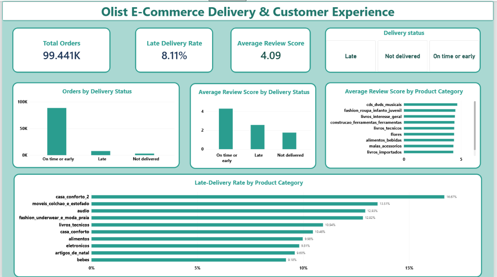
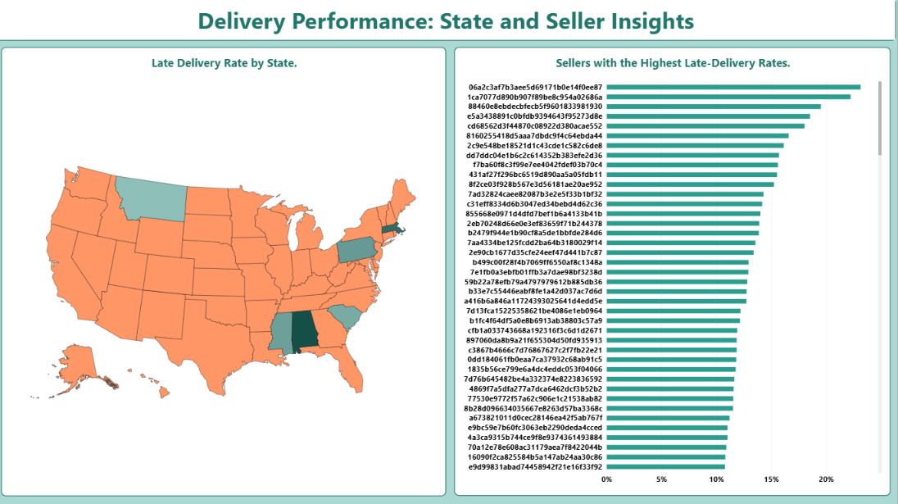

# Olist E-commerce Delivery and Customer Experience Analysis

## Project Overview
This project analyzes Olist e-commerce data to evaluate delivery performance and customer satisfaction using SQL Server and Power BI.

## Tools Used
- SQL Server
- Power BI

## Key Findings
- The late-delivery rate was **8.11%** among **96,470 delivered orders with both delivery dates available**.
- Among product categories with at least **500 delivered orders**, Electronics had the highest late-delivery rate (**9.81%**), followed by Babies (**9.18%**).
- Late-delivery orders had an average review score of **2.57**, compared with **4.29** for orders delivered on time or early.

## Recommendations
- Investigate delivery delays in Electronics and Babies, the two highest-rate categories in the analyzed category set.
- Monitor delivery performance alongside customer review scores. The difference shows an association with late delivery, but does not prove that delays were the only cause of lower ratings.
- A **2-percentage-point reduction** in the late-delivery rate would correspond to approximately **1,929 fewer late deliveries** across the analyzed 96,470 orders. This is a hypothetical estimate, not a measured result.

## Project Files
- `Olist_Portfolio.sql` — SQL analysis queries
- `Customer Experience.png` — First dashboard screenshot
- `delivery-performance-2.png` — Second dashboard screenshot

## Dashboard

